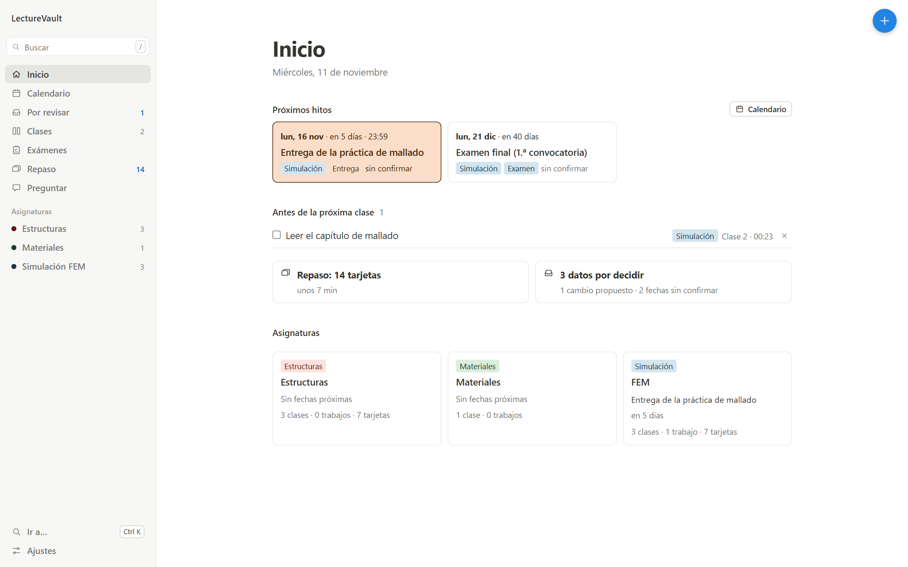
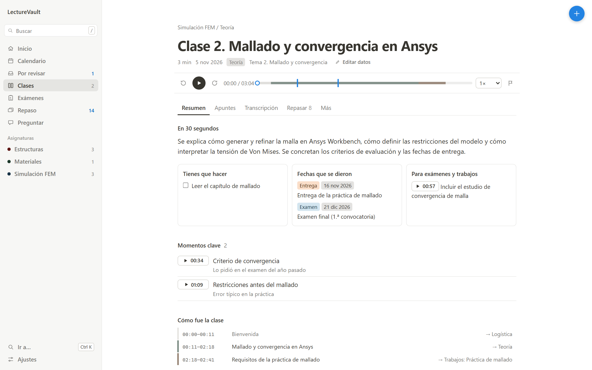
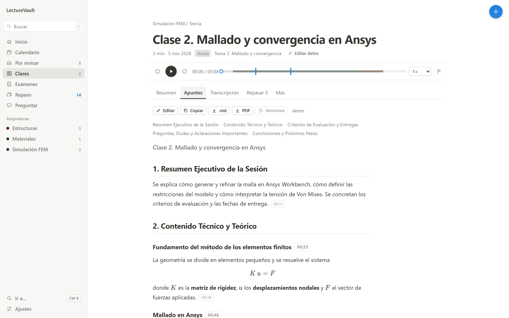
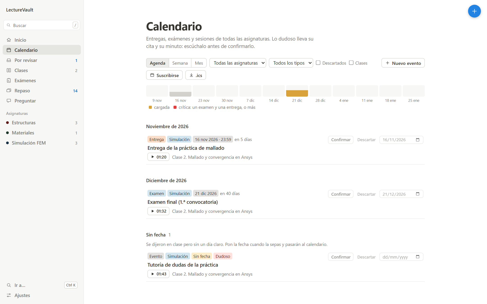
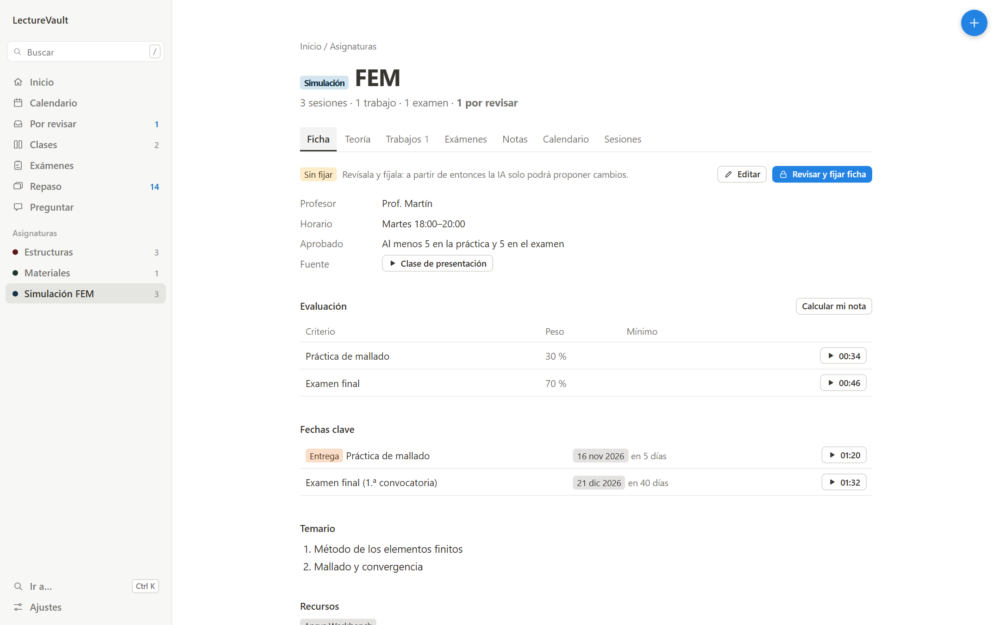
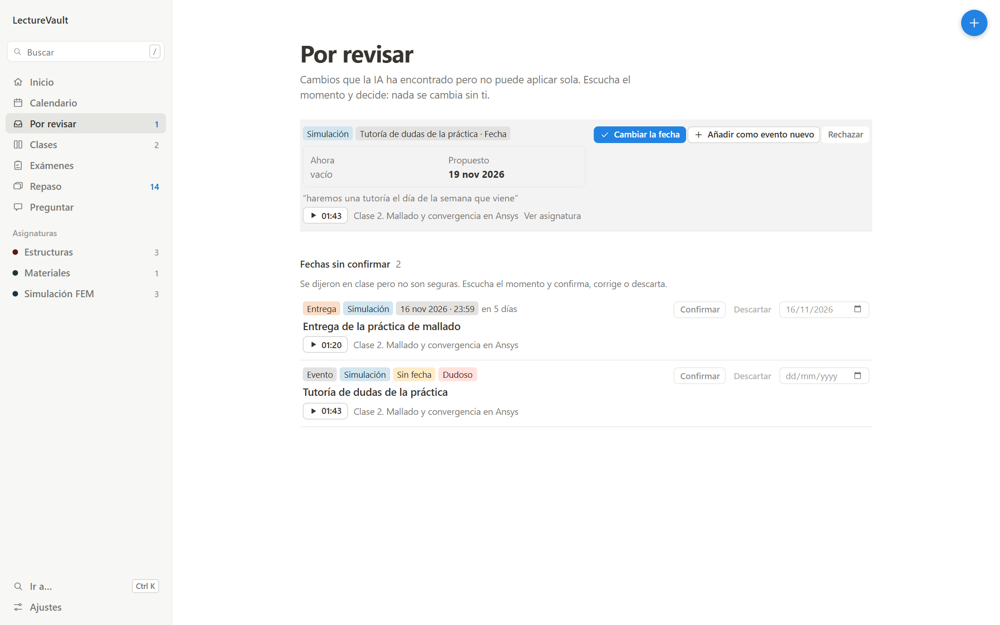
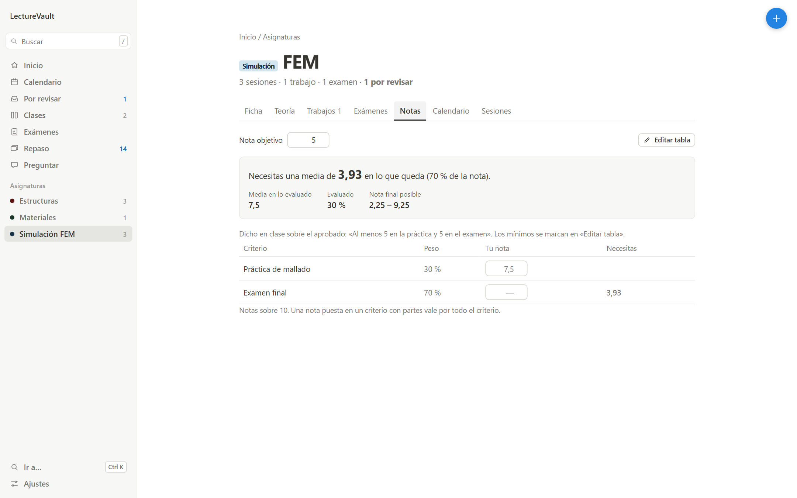
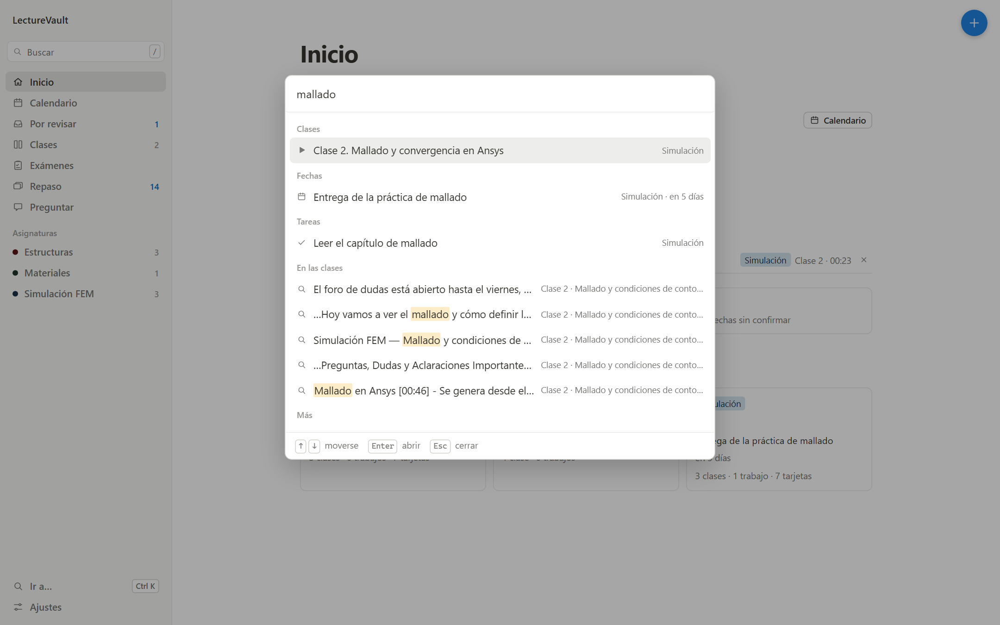

# LectureVault

A local-first academic recording assistant that extracts metadata from
Blackboard Collaborate Ultra (Collab2) recordings and displays them in
a clean local dashboard.

Beyond metadata, LectureVault now captures the audio of a class, transcribes it
**locally** (faster-whisper) and turns it into a personal study campus: interactive
notes with timestamps, instant search, exam/deadline alerts with a calendar, Anki
flashcards and a Q&A assistant that answers with verified quotes from your classes.
See [docs/study-copilot.md](docs/study-copilot.md) for how it works and where everything is stored.

```bash
npm run demo     # try the whole dashboard with sample classes (separate folder, no setup)
```

## Screenshots

Taken with the built-in demo data (fictional classes), with `npx tsx scripts/take-screenshots.ts`.

| | |
|---|---|
|  |  |
| Home: upcoming dates, what to do before the next class, review | Class summary: tasks, dates, key moments and how the class went, each linked to its minute |
|  |  |
| Notes with timestamps and formulas | Calendar with weekly load, `.ics` export and subscription |
|  |  |
| Course sheet: teacher, schedule, grading, key dates, syllabus | Changes the AI found but does not apply by itself: you listen to the minute and decide |
|  |  |
| Grade calculator: what you need in what is left to reach a target | Command palette (Ctrl+K) over classes, dates, tasks and transcript phrases |

## What changed since the first release

The project started as a recording list with local transcription. It is now organised by subject:

- **Subjects**: a sheet per subject (teacher, schedule, grading, key dates, syllabus), with theory, assignments, exams, grades and sessions.
- **Session analysis**: each class is split into time ranges (presentation, theory, project, exam, logistics) and each range goes to its place. Dates are only kept if the day was actually said in the transcript; otherwise they wait in a review inbox.
- **Notes per range** with timestamps, formulas, callouts and optional plots and diagrams; the model's output is validated (figures and dates that the class does not say are dropped or flagged).
- **Calendar**: one calendar for every subject, weekly load, `.ics` export and subscription, and optional import of the university's own calendar feed.
- **Exam question bank** built from the transcripts, with a practice mode that grades at the end.
- **Background AI queue** and a nightly agent (GitHub Actions) that records new classes and prepares notes.
- **Safer defaults**: database copies before each migration, trash instead of deletion, uploads to git only if you opt in and never to a public repository.

## About this repository

This is a code-only copy. Classes, transcripts, notes and course materials stay on the author's machine and in a private repository, and `data/` is ignored here. Some unit tests that depend on a real class transcript are not included in this copy; the rest (`npm test`) run without any data or API key.

---

## Features

- 🎓 **Persistent browser session** — Chromium with a local profile so
  you only log in once
- 🔒 **Zero credential storage** — The app never requests, stores, logs,
  or hardcodes any credentials
- 📋 **Automatic metadata extraction** — Title, date, duration, and
  playback link from Collab2 recordings
- 💾 **SQLite storage** — Local database tracks new vs. previously
  seen recordings
- 📊 **Local dashboard** — Clean web UI with filtering, sorting, and
  stats (localhost only)
- 📝 **Structured logging** — JSON logs with sensitive field redaction
- 📸 **Screenshots on failure** — Automatic capture for debugging
- 🎧 **Study campus** — player with alert markers, synced transcript, notes with clickable `[mm:ss]` + formulas
- 🔎 **Global search** — FTS5, accent/typo tolerant, jumps to the exact minute
- ⚠️ **Critical alerts + calendar** — exams, deadlines, grading, warnings → `.ics`
- 🃏 **Flashcards** — spaced repetition in the dashboard and Anki export (basic + cloze)
- 💬 **Ask your classes** — hybrid retrieval with verified citations

## Prerequisites

- [Node.js](https://nodejs.org/) ≥ 20.0.0
- npm (comes with Node.js)
- [Python](https://www.python.org/) 3.10 - 3.12 (for local speech-to-text with `faster-whisper`)
- [FFmpeg](https://ffmpeg.org/) (e.g. `winget install Gyan.FFmpeg` on Windows)

## Quick Start (New Machine Setup)

```bash
# 1. Clone the repository
git clone <repo-url>
cd lecturevault

# 2. Install Node.js dependencies
npm install

# 3. Create Python virtual environment and install faster-whisper
python -m venv .venv
.\.venv\Scripts\python.exe -m pip install --upgrade pip
.\.venv\Scripts\python.exe -m pip install -r requirements.txt

# 4. Configure environment variables
cp .env.example .env
# Edit .env with your LMS URL, course identifier, and allowed hosts

# 5. Capture and transcribe a class: start the dashboard and press the "+" in the top right corner
#    (pick the subject; the campus opens, you play the class and press "Empezar a grabar"),
#    or "Grabar y transcribir" in Clases › Pendientes, or run it from the terminal
npm run serve
npm run capture:and:transcribe
```

`npm run serve` runs the TypeScript directly. To run the compiled version instead: `npm run build` and then `npm start`
(`build` empties `dist/` first, so nothing stale is left behind).

## Configuration

Copy `.env.example` to `.env` and set:

| Variable | Description | Default |
|----------|-------------|---------|
| `LMS_BASE_URL` | Your university's Blackboard URL | `https://example.blackboard.com` |
| `COLLAB_RECORDINGS_PATH` | Path to recordings page | `/ultra/courses` |
| `BROWSER_HEADED` | Show browser window | `true` |
| `DASHBOARD_PORT` | Dashboard port (localhost only) | `3000` |
| `LOG_LEVEL` | Log verbosity | `info` |
| `GEMINI_API_KEY` | Optional: notes, alerts, flashcards, Q&A | — |
| `DATA_DIR` | Root for audio/transcripts/exports; the database, logs and browser profile live in it too unless their own variable says otherwise. Relative paths are relative to the project folder | `./data` |
| `BACKUP_DIR` | Where database copies go (daily, before each update, and from Ajustes) | `./backups` |
| `AUTO_GIT_SYNC` | Commit and push each new transcript to your git remote (only from `GIT_SYNC_BRANCH`, and never to a public GitHub repository unless `GIT_SYNC_ALLOW_PUBLIC=true`) | `false` |

See [.env.example](.env.example) for all options.

## Usage

### Commands

```bash
# Sync: Open browser, navigate to Collab2, extract recordings
npm run sync

# Serve: Start the dashboard (no browser)
npm run serve

# Both: Sync then start dashboard
npm run dev

# Study copilot (see docs/study-copilot.md)
npm run ingest                 # import data/transcripts into SQLite
npm run study                  # notes, alerts, flashcards (needs GEMINI_API_KEY)
npm run search -- "Von Mises"  # instant full-text search
npm run ask -- "¿Qué entra en el examen?"
npm run export                 # Anki, .ics, Obsidian → data/exports
npm run demo                   # sample library + dashboard
```

### First Run

1. Run `npm run sync` — A Chromium browser window opens
2. Navigate to your university's login page and log in manually
3. The app detects authentication and proceeds to extract recordings
4. Recording metadata is saved to the local SQLite database
5. Run `npm run serve` and open http://localhost:3000

### Subsequent Runs

The browser profile persists your session. If the session expires, the
app will detect it and wait for you to re-authenticate.

## Project Structure

```
src/
├── index.ts              # Main entry point / CLI
├── types.ts              # Shared TypeScript interfaces
├── browser/
│   └── BrowserManager.ts # Playwright persistent context
├── navigator/
│   └── PageNavigator.ts  # Page state detection & navigation
├── extractor/
│   └── RecordingExtractor.ts # DOM scraping for metadata
├── database/
│   └── DatabaseManager.ts # SQLite storage layer
├── dashboard/
│   └── DashboardServer.ts # Express server + API
└── utils/
    ├── config.ts          # Environment config loader
    └── logger.ts          # Structured pino logger
public/
└── index.html             # Dashboard UI
tests/
├── unit/                  # vitest unit tests
└── e2e/                   # Playwright E2E tests
docs/
├── architecture.md
├── threat-model.md
├── implementation-plan.md
└── test-plan.md
data/                      # (gitignored) runtime data
├── browser-profile/       # Chromium profile
├── lecturevault.db        # SQLite database
├── logs/                  # Application logs
└── screenshots/           # Failure screenshots
```

## Testing

```bash
# Unit tests
npm test

# Unit tests (watch mode)
npm run test:watch

# E2E tests
npm run test:e2e

# Type checking
npm run lint
```

## Security

- **No credentials**: The app never touches passwords, tokens, or MFA codes
- **Read-only browsing**: Never submits forms, modifies content, or sends messages
- **Localhost only**: Dashboard is bound to 127.0.0.1
- **Log redaction**: Sensitive fields are automatically redacted
- **URL sanitization**: Query parameters stripped from logged URLs
- **Gitignored data**: Browser profiles, database, screenshots, and logs
  are excluded from version control

See [docs/threat-model.md](docs/threat-model.md) for the full security analysis.

## Milestone Roadmap

- [x] **Milestone 1**: Metadata extraction and dashboard (accepted against real Collab2)
- [x] **Milestone 2**: Read-only player capability inspection & sanitization
- [x] **Milestone 3**: In-browser digital audio capture pipeline (zero mic, FFmpeg 16kHz mono normalization)
- [x] **Milestone 4**: Local-only faster-whisper speech-to-text proof of concept (TXT/SRT/VTT/JSON, auto-stop)
- [x] **Milestone 5**: Study copilot — timestamped notes, FTS5 search, alerts + calendar, flashcards, RAG Q&A, campus dashboard

## License
 
MIT License. See [LICENSE](LICENSE) for details.
